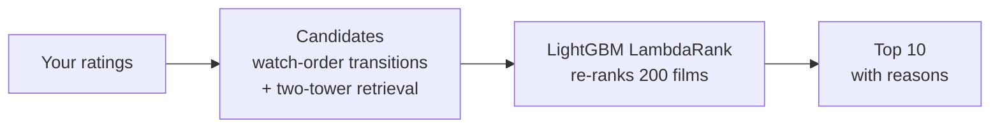
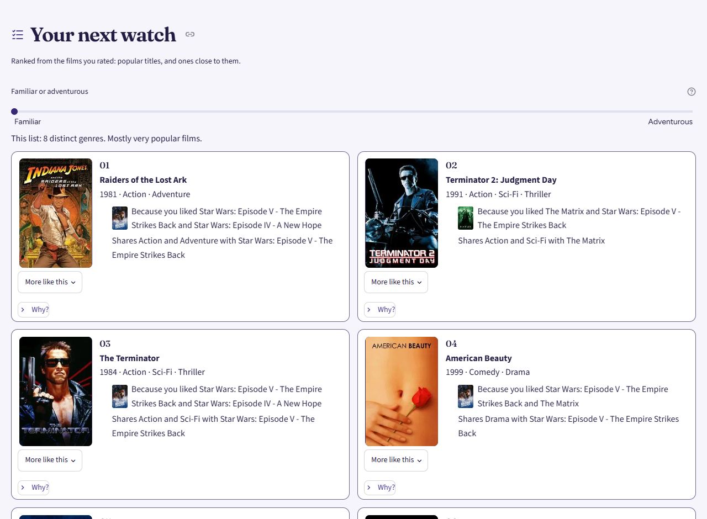
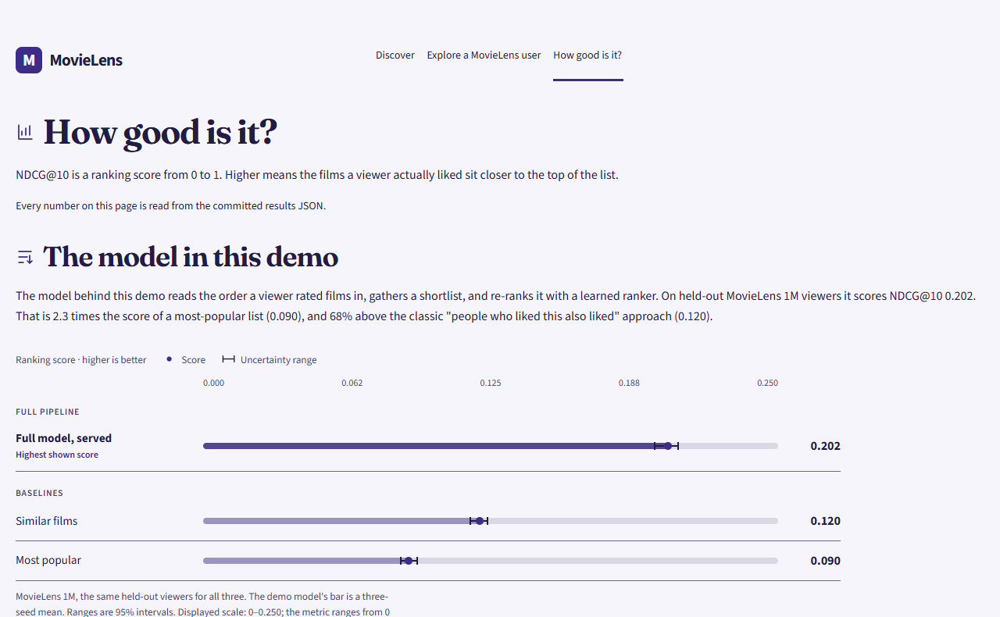

# MovieLens Recommender

[](https://nikosmav-movielens-recommender.streamlit.app/)

[](https://nikosmav-movielens-recommender.streamlit.app/)
[](https://github.com/NikosMav/movielens-recommender/actions/workflows/ci.yml)

[](LICENSE)

**Rate three films and get ten picks, each with the reason it was chosen.** A movie recommender built from scratch on [MovieLens](https://grouplens.org/datasets/movielens/) ratings, measured strictly enough that failed ideas are published as failures.

**[Try the live demo →](https://nikosmav-movielens-recommender.streamlit.app/)**

**Short on time?** In Discover, select **Try a sample profile**, then **Change one rating** to see which movies enter or leave the list.

## At a glance

- **For existing viewers, 2.3× the ranking score of a most-popular list.** The served model reads the order a viewer rated films in and re-ranks a shortlist with LightGBM. On held-out MovieLens 1M viewers it scores NDCG@10 **0.202**, against **0.090** for a most-popular list and **0.120** for the classic "people who liked this also liked" approach, 68% higher. The model was chosen by a rule written down before the test ran ([ADR-0033](docs/adr/0033-pctm-in-the-ranker.md)).
- **Every pick explains itself.** A card names the films you rated that led to it ("Because you liked …"), and a details panel shows what drove the ranker's score.
- **It works for strangers.** You don't need a MovieLens account: rate a few films and a model trained on short profiles takes over. From three ratings it beats a list of the most popular films ([ADR-0012](docs/adr/0012-new-user-cold-start.md)).
- **Negative results stay in.** The two-tower model did not beat item–item on its gate. Two attempts at a larger, post-2000 catalogue missed their ship rule. Both are written up ([ADR-0006](docs/adr/0006-two-tower-retrieval.md), [ADR-0034](docs/adr/0034-extended-discover-catalogue.md), [ADR-0035](docs/adr/0035-extended-catalogue-popularity-blend.md)).



**What's inside.** A per-user time split and an evaluation harness with bootstrap confidence intervals. More than ten models, tuned on validation only: popularity, item–item, ALS, EASE, EASE-DAN, RP3beta, a PyTorch two-tower model, SASRec, eSASRec, pairwise transitions, and a LightGBM ranker. A Streamlit app, a FastAPI service with batch scoring and Prometheus metrics, a Docker image, a drift-and-retraining replay, CI on every change, and 35 decision records. The same harness runs on ml-latest-small, ml-1m, and MovieLens 32M.

## Contents

- [Results in brief](#results-in-brief)
- [The demo](#the-demo)
- [Quickstart](#quickstart)
- [How it is evaluated](#how-it-is-evaluated)
- [Project layout](#project-layout)
- [Documentation](#documentation)
- [Tests and CI](#tests-and-ci)
- [License and data terms](#license-and-data-terms)

## Results in brief

Test NDCG@10 on MovieLens 1M held-out viewers (higher is better). Every number is read from the committed `results/*.json` files; the [full results](docs/results.md) have intervals, more metrics, and the other two datasets.

| Model | NDCG@10 |
| --- | --- |
| **Served ranker:** LambdaRank over watch-order and two-tower candidates ([ADR-0033](docs/adr/0033-pctm-in-the-ranker.md)) | **0.2021** |
| Pairwise watch-order transitions alone (PCTM) | 0.1787 |
| The same ranker without watch order | 0.1309 |
| Item–item cosine, the classic "people who liked this also liked" baseline | 0.1201 |
| Two-tower retrieval (PyTorch) | 0.1192 |
| Most popular films | 0.0895 |

- **2.3 times a most-popular list, 68% above the classic approach.** The served model scores 0.202, against 0.090 for recommending the most popular films and 0.120 for item–item similarity.
- **Watch order is what makes the difference.** The same ranker without it scores 0.131 (paired gain +0.072, 95% interval +0.067 to +0.078). Demographics add nothing once order is in, so the served model uses none.
- **Negative results are reported.** The two-tower model did not beat item–item on its gate, SASRec and eSASRec trail the simple transition model, and a larger post-2000 catalogue missed its ship rule twice.
- **New users are covered.** From three ratings, the new-user model beats the most-popular list ([ADR-0012](docs/adr/0012-new-user-cold-start.md)).

## The demo

The [live demo](https://nikosmav-movielens-recommender.streamlit.app/) runs on Streamlit Community Cloud and has three sections:

- **Discover.** Search a title or browse a genre shelf, rate films you have seen, and get ten picks, each with the films behind it.
- **Explore a MovieLens user.** Look up a viewer id and see the served model's list, with a comparison against simpler models.
- **How good is it?** A plain summary and chart, read from the committed results.





The screenshots and the animation are from the live page, recorded with `python scripts/record_demo.py both`. Poster images come from [TMDB](https://www.themoviedb.org/). This product uses the TMDB API but is not endorsed or certified by TMDB. Deployment details are in [docs/serving.md](docs/serving.md).

## Quickstart

Requires Python 3.10+.

```bash
python -m venv .venv
source .venv/bin/activate          # Windows: .venv\Scripts\activate
pip install -r requirements.txt
pip install torch==2.6.0 --index-url https://download.pytorch.org/whl/cpu
pip install -e ".[dev,deep,rank,ui,api]"

streamlit run space/app.py         # the public app; downloads weights and ml-1m on first run
```

To build the models from scratch, run the HTTP API, or use Docker, see [docs/serving.md](docs/serving.md). To rerun the experiments, see [docs/evaluation.md](docs/evaluation.md#reproducing-the-results).

## How it is evaluated

Each viewer's last 20% of ratings, by time, is the test set, and the 10% before that is validation. Every model is tuned on validation only, refit, and scored once on test. A rating of 4 or more counts as relevant. Scores are NDCG@10 averaged over viewers, with 95% bootstrap intervals, and model comparisons use paired intervals on the same viewers. Each experiment's ship rule was written in an ADR before it ran. Full details: [docs/evaluation.md](docs/evaluation.md) and [docs/problem.md](docs/problem.md).

## Project layout

| Path | What is there |
| --- | --- |
| `src/movielens_recommender/` | The package: data, split, metrics, evaluation, tuning, and the `movielens-recommender` CLI |
| `src/movielens_recommender/baselines/` | Most popular, item–item cosine, ALS, EASE^R, EASE-DAN, RP3beta |
| `src/movielens_recommender/two_tower/` | Two-tower model, features, training losses, and the S3e budget planner |
| `src/movielens_recommender/sasrec/` | Causal self-attentive sequence recommender (SASRec) and shuffled-order control (ADR-0019) |
| `src/movielens_recommender/ranker/` | Candidate sets, ranker features, LambdaRank training, SHAP explanations, demographics |
| `src/movielens_recommender/serving/` | Serving snapshots (build, save, load), new-user serving, plain-language reasons, batch scoring, the HTTP API and its monitoring |
| `src/movielens_recommender/ops/` | Drift signals and the time-ordered refresh replay (S6) |
| `Dockerfile` | API image; holds no MovieLens data or snapshot |
| `app/streamlit_app.py` | Local research Streamlit page (lightweight existing-user and new-user snapshot inspector) |
| `space/` | Public showcase Streamlit app (`space/app.py`), custom light/dark visual system, posters, discovery controls, and benchmark views |
| `frontend/` | Standalone React 19 + Astryx local API client (`frontend/README.md`) |
| `configs/` | Run configs: `default.yaml` (ml-latest-small), `ml-1m.yaml`, `ml-32m.yaml` |
| `scripts/` | Results-table generator, EDA, and one-off experiment runners |
| `results/` | Committed experiment logs: metrics, intervals, tuning trials, budgets |
| `docs/problem.md` | Task definition, metrics, and the stage-gate rule |
| `docs/adr/` | One decision record per design choice and stage |
| `docs/eda/` | Aggregate EDA stats and figures (no raw data) |
| `tests/` | Unit tests on synthetic data |

## Documentation

| Page | What is there |
| --- | --- |
| [docs/results.md](docs/results.md) | Every finding and every generated results table |
| [docs/evaluation.md](docs/evaluation.md) | Data, evaluation protocol, models, reproducing the results, project stages |
| [docs/serving.md](docs/serving.md) | Deploying the demo, the HTTP API, batch scoring, Docker, the React frontend |
| [docs/adr/](docs/adr/) | 35 decision records, one per design choice and experiment |
| [docs/reviews/](docs/reviews/) | Demo reviews and comparisons with other movie discovery tools |

## Tests and CI

```bash
pytest -q
ruff check src tests scripts app space
```

GitHub Actions runs ruff and pytest on Python 3.10 and 3.12 with the CPU PyTorch wheel. Tests use synthetic data only; `MOVIELENS_ALLOW_DOWNLOAD=0` blocks downloads in CI. A second job type-checks and builds the React frontend and verifies the committed `space/astryx_ui` bundle. A third builds the Docker image and checks that a container with no snapshot answers `/health` with 503. A separate scheduled workflow opens the public demo in a headless browser every four hours (`scripts/keep_awake.py`), so Community Cloud does not put it to sleep, and fails visibly if the app does not come up.

## License and data terms

The code is MIT ([LICENSE](LICENSE)). The MovieLens data is not included: the scripts download it, and it stays under the [GroupLens terms of use](https://grouplens.org/datasets/movielens/) for every dataset used here, ml-32M included. The Community Cloud app downloads ml-1m the same way and does not commit it (ADR-0020).
