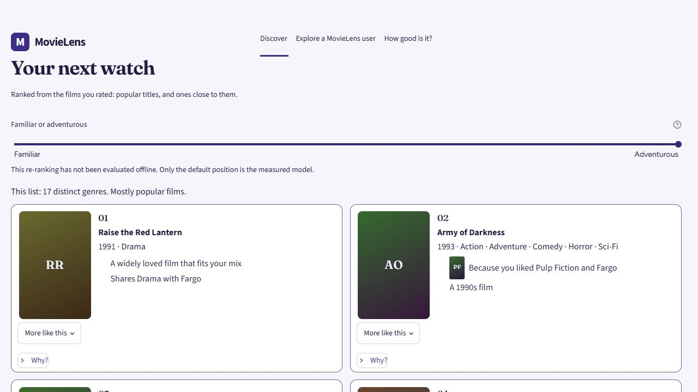
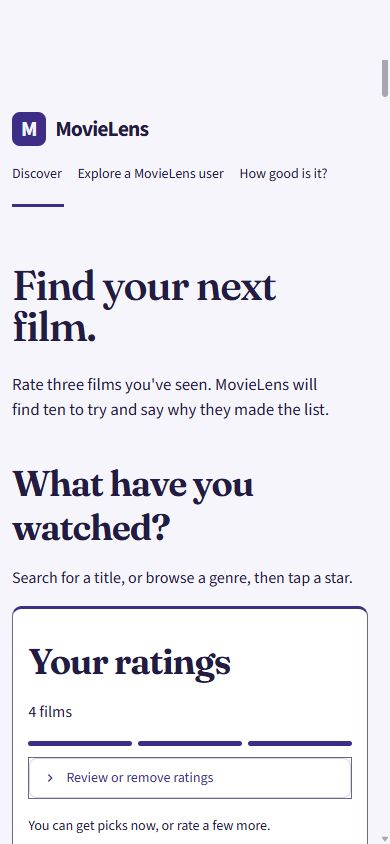

# MovieLens demo review — 11 November 2026

The demo has value as an inspectable recommender engineering project and as a
way to explore older films. Its strongest distinction is the connection between
an interactive recommendation, an explanation, and reproducible evaluation.
It has not established that people prefer its picks to those of a consumer
recommendation service.

## Scope and comparison research

The starting production revision was `4b2f40b`. The deployed entrypoint is
`space/app.py`, with native Streamlit views in `space/pages.py`. The React and
Astryx frontend remains a separate local API client; replacing the live page
with it would remove existing features and is outside this refinement.

Public sources were inspected on 11 November 2026. These comparisons describe
published features, not a hands-on assessment of signed-in competitor accounts.

| Source | Relevant pattern | Decision for this demo |
| --- | --- | --- |
| [MovieLens](https://movielens.org/) | Build a taste profile with ratings, inspect rich movie information, adjust recommendations | Keep rating and exploration central; make the adjustment's actual effect visible |
| [Taste](https://www.taste.io/press) | Ratings lead to personal recommendations; browsing includes hidden gems and saved films | Make samples explicit and test whether adventurous picks actually differ |
| [Letterboxd](https://letterboxd.com/faq/) | Record watched films, ratings, lists, and a watchlist | Sharing should preserve a usable selection; persistent watchlists would require a separate product decision |
| [dutta-sujoy/Movie-Recommendation-System](https://github.com/dutta-sujoy/Movie-Recommendation-System) | A selected title yields similar films with TMDB posters in Streamlit | Similarity and posters are already common; another poster grid alone adds little distinction |
| [Astryx component catalog](https://astryx.atmeta.com/components/) | Existing controls for forms, navigation, feedback, and overlays | Retain the repository's Astryx client, but fix the deployed native UI without introducing another rendering layer |

The evaluation distinction matters: predicting held-out positive ratings is
different from predicting interest in watching a recommendation. The authors
of [Extending MovieLens-32M to Provide New Evaluation Objectives](https://arxiv.org/abs/2504.01863)
construct a collection around the latter objective. This supports keeping
behavioral checks and existing ranking scores separate from claims about
viewer satisfaction.

## Round 1: production review and fixes

The live app was exercised in desktop and emulated phone layouts. Source
inspection traced controls to the data they actually use.

| Priority | Finding | Result |
| --- | --- | --- |
| P1 | “Copy link” printed a success message without using the clipboard, and could append a second query string | “Share these picks” reveals a public URL and the native code-box copy action; no false success claim |
| P1 | Sharing omitted the slider setting | Links contain the profile and `mix=0..4`; a fresh session restores both |
| P1 | “Why not?” used the original model order after the displayed list changed | It checks displayed membership first, then clearly identifies the original candidate rank; ambiguous searches offer a film selector |
| P1 | Editing ratings left old cards and sharing tools usable with a new profile | Stale picks are withheld until refresh; fewer than three ratings disables refresh |
| P1 | Low-rated films could become “Because you liked” explanations | Four stars is the display threshold for liking; other rated-film evidence uses neutral similarity wording |
| P2 | Phone visitors had to pass the full shelf to reach the ratings action | The ratings panel precedes browsing on phones; detailed ratings collapse; decorative hero art stays on wider screens |
| P2 | Narrow two-column shelves compressed star targets | Small shelves use compact single-column rows with 44×44 star targets |
| P2 | Genre sample buttons silently assigned five-star ratings and overwrote some existing preferences | Sample actions explicitly state that they replace the profile with up to four five-star films |
| P2 | Search did not explain why modern titles were absent | Search states that MovieLens 1M contains releases through 2000 and offers recovery guidance |
| P2 | Switching sections from a long list retained the old scroll position | Section changes reset the main scroll area after rendering |

## Round 2: confirmation and edge cases

The revised app was exercised against snapshots reconstructed from the same
checksum-verified weight archive used by deployment:
`f6cbc0d77d435834493b85835215211874307d827ac2910121894bb56be7dbfd`.
An older snapshot already in `artifacts/` differed from the deployment snapshot;
it was not used for the final recommendation regression check.

Confirmation found a missing-poster edge case: evidence placeholders lost their
thumbnail class and inherited the full poster dimensions. The placeholder now
keeps its extra class, and the thumbnail selector takes precedence over full
poster styles. Remote poster images also load lazily and decode asynchronously.
The brand link now keeps its intended theme color rather than browser link blue.

## Does the adventurous control add value?

`python scripts/check_demo_controls.py` checks four fixed demonstration profiles
at all five positions against `space/.runtime/cold_start`. It asserts ten unique
films, exclusion of the rated films, membership in the retrieved candidates,
and exact agreement with the served order at the default position. No fitting
or result-file rewriting occurs.

| Profile | Default mean popularity percentile | Adventurous mean percentile | Genres, default → adventurous | Picks retained at endpoint |
| --- | ---: | ---: | ---: | ---: |
| Animation | 99.59 | 79.76 | 10 → 12 | 0/10 |
| Crime | 99.56 | 86.90 | 11 → 17 | 0/10 |
| Science fiction | 99.67 | 86.26 | 8 → 13 | 0/10 |
| Mixed ratings | 99.73 | 89.03 | 9 → 15 | 0/10 |

These are properties of four displayed lists, not population estimates or
relevance scores. The endpoint creates materially different lists with less
popular films. It still retrieves from a restricted candidate pool. A small
move may keep the same films, and genre count and average popularity need not
change monotonically because the diversity penalty also affects selection.
There is no evidence here that maximum adventure gives better recommendations.

## Validation and limits

The post-merge production check found a deployment-specific failure that the
editable local installation did not reproduce: `space/requirements.txt` still
installed backend revision `2f48c5f`, predating the candidate trace added for
the slider, why-not answer, and funnel. The new UI was deployed, but a restored
adventurous setting still displayed the default picks. The backend dependency
is now pinned to `02a07ab`, which includes that trace and preserves the earlier
memory fixes. The UI also withholds adjustment and candidate-rank answers if
trace data is missing, rather than implying that those controls worked.

- Full Python suite after the deployment follow-up: 274 passed, including the pinned existing-user and new-user
  recommendation IDs; Ruff passed. The suite reports one upstream Starlette /
  AnyIO deprecation warning.
- Nine new control/profile regressions plus one missing-poster regression cover
  sharing, slider-aware answers, stale results, sample replacement, restoration,
  low ratings, missing candidate traces, and thumbnail classes.
- A separate deployment contract check installs the exact requirements pin into
  an isolated directory and exercises its scored candidate trace in an isolated
  Python subprocess. CI runs this check after the editable-source tests, so a
  future package pin cannot silently omit the trace required by the UI. The
  four-profile probe was also repeated against this installed package.
- Both frontend builds passed. Windows line-ending changes in the generated
  archived bundle were discarded; its committed content is unchanged.
- The committed `results/` files are unchanged. Models, retrievers, ranker
  features, and training settings are unchanged.
- The design detector reported the retained Fraunces font and a false positive
  on an image-tag mention in a docstring. Neither calls for a functional change.
- Phone checks use an emulated Chromium viewport, not a physical touch device.
  Discover has no page overflow at 390 px, its star targets are 44×44 px, and
  Explore's viewer controls fit at 320 px. A fresh shared-link session restores
  the same ten picks and the adventurous slider position. The desktop light
  theme retains 28×42 px evidence thumbnails even without a poster API key.
  Palette contrast tests cover both themes; this is not a complete accessibility
  certification or a new measurement of the Linux server memory budget.

The next evidence needed for a consumer-product claim is a small user study:
give viewers a choice between the default and adjusted lists, and record which
films they would actually watch. Adding streaming availability, a contemporary
catalog, or accounts would be a separate expansion. The current project can be
presented confidently for its engineering and transparent findings.

## Review captures

These local captures intentionally exercise the no-API-key poster fallback.

